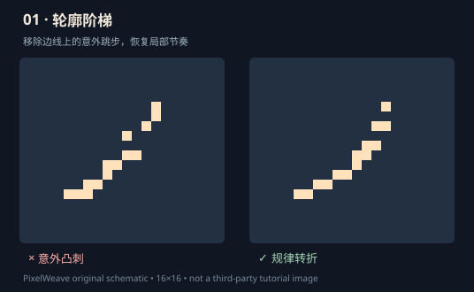
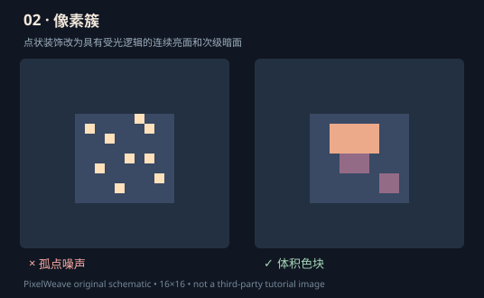

# L0 实验：像素簇与轮廓的逐像素修订

来源：Pixel Joint / cure 综合教程：https://pixeljoint.com/forum/forum_posts.asp?TID=11299 。本实验示意及练习均为 PixelWeave 原创，不复制原教程图片。

## 对照 1：轮廓台阶

**流程：**
1. 在 Studio 隐藏填充/高光，只看单色轮廓，1× 观察大形。
2. 放大 8×，寻找不符合目标曲线的突然跳步，记录 (x,y)。
3. 先“移动”而不是“补满”：原位置去掉一个像素，在目标边上补一个像素。
4. 检查负空间是否因修复变窄或闭合；再缩回原尺寸。
5. 两份工程保留 before/after，记录调整坐标及原因。

不等长台阶不一定错误。岩石、荆棘和破损刀锋可能需要突然转折；检查意图，而不是仅统计转角。

## 对照 2：像素簇还是散点噪声？

1. 将主物体分成暗面、主色、亮面三个连续块。
2. 隐藏全部微高光；把 5–10 个随机单像素亮点重新组织成 1–2 个受光面。
3. 返回 1× 看体积。原尺寸更清楚时才继续细化。
4. 眼睛、火花、星点允许独立像素：孤点不是绝对错误，必须有语义。

## 可编辑的完整练习

[下载原创钥匙工程](../examples/reference/readable-key.layered.json)。Studio → 导入 JSON → 分别隔离 contour / fill / glint 三层。

- 仅显示 contour：柄部孔洞必须看得出。
- 显示 fill：检查杆身明暗是否沿一致方向。
- 显示 glint：高光必须辅助金属阅读，而不是破坏剪影。
- 故意在钥匙柄边缘画一枚突刺，再用单像素移动修复，导出两个 JSON 版本。
- 找另一人不看文件名识别图案；不要把模型自评当外部识别测试。

**出口门槛**：1× 可识别、轮廓连续、像素簇有职责、可以给出具体修改坐标、全部帧与图层通过数据校验。

拓展阅读：Slynyrd 基础 https://www.slynyrd.com/blog/2018/5/16/pixelblog-5-back-to-basics 。
