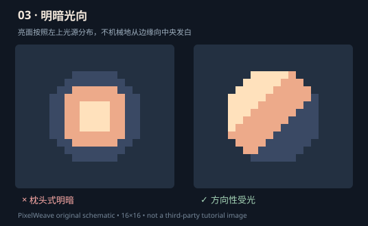
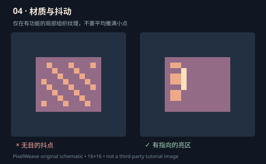

# L1 实验：方向光、受光面、材质差异

来源：Slynyrd 色板、光影和纹理专题；Pixel Joint pillow shading / dithering 技法。所有对比图为 PixelWeave 自制示意，非作者原图。

## 光照示意

所谓 pillow shading 的常见问题不是中间亮色本身，而是没有光源或形体解释，机械沿边缘一圈圈变亮。

- 步骤 1：在旁边写明主光位于左上，别让模型自行改变光源。
- 步骤 2：只用暗部 / 中间色 / 亮部三种明度组画形体；不要提前加纹理。
- 步骤 3：放大检查受光面是否遵从形体的朝向。
- 步骤 4：灰度 1× 检查主次；再决定是否做 Hue Shifting（明暗色相变化）。
- 例外：中央发光的魔晶或正面打光的人像，中心亮是合理的。

## 材质：抖动不是万能精致滤镜

从 1× 看是否因为细碎色点丢失了体积。Dithering 可用于特定复古风格，不能仅因为某种“反噪声”规范就全部禁用，也不能缺少设计意图而覆盖整个物体。

## 三件可编辑对照素材

| 素材 | 单独检查的层 | 应形成的效果 |
| --- | --- | --- |
| [玻璃药水](../examples/reference/scarlet-vial.layered.json) | glass / reflections / liquid | 玻璃边缘、液体内部与反光相互独立 |
| [黄铜提灯](../examples/reference/hearth-lantern.layered.json) | frame / highlights / flame | 固定金属框架，局部受光解释灯火 |
| [多面晶体](../examples/reference/prism-crystal.layered.json) | shape / facets / shimmer | 每个切面的明暗属于同一形体，闪光只是次级 |

**实作**：各复制一份工程。错误版增加 8–10 个分散亮点；修正版删去无意义亮点，重新以材质受光区域聚类，保持总色数不变。记录三个物体的主光方向和至少一个具体修复区域。

**出口门槛**：隐藏 highlights 后主体可读；玻璃、金属、晶体有不同反光逻辑；只有经过外部观众原尺寸辨识，才可声称“材质识别通过”。

延伸：[色板](https://www.slynyrd.com/blog/2018/1/10/pixelblog-1-color-palettes)、[光影](https://www.slynyrd.com/blog/2018/6/15/pixelblog-6-light-and-shadow)、[纹理](https://www.slynyrd.com/blog/2018/2/15/pixelblog-2-texture)。
